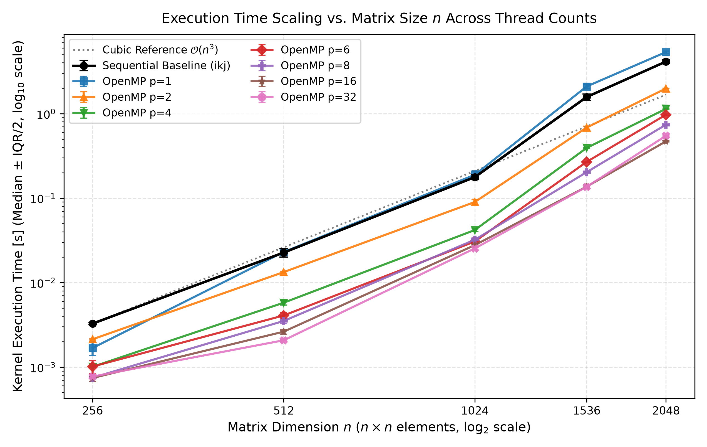
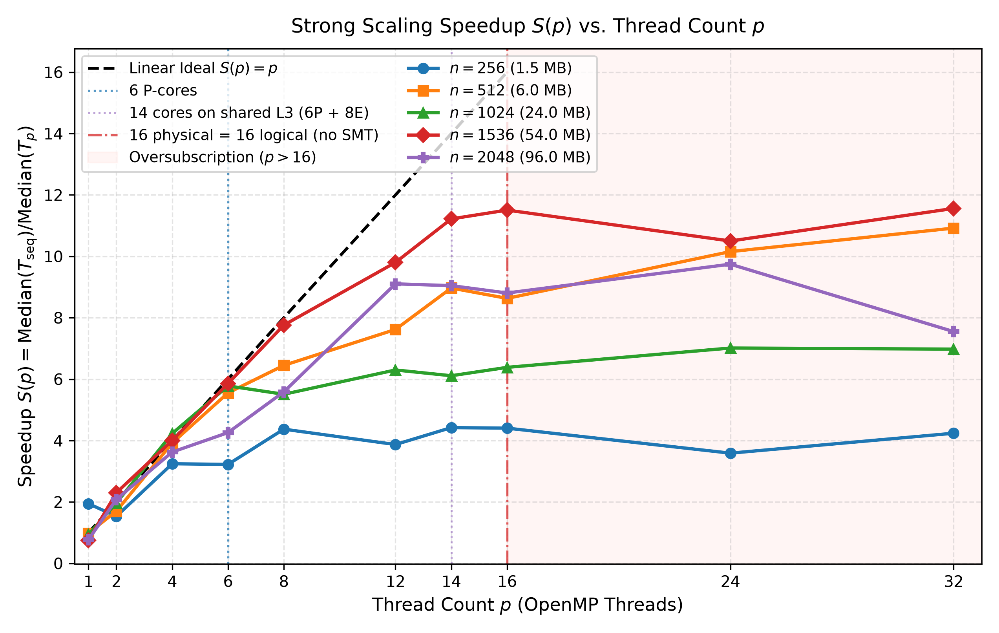
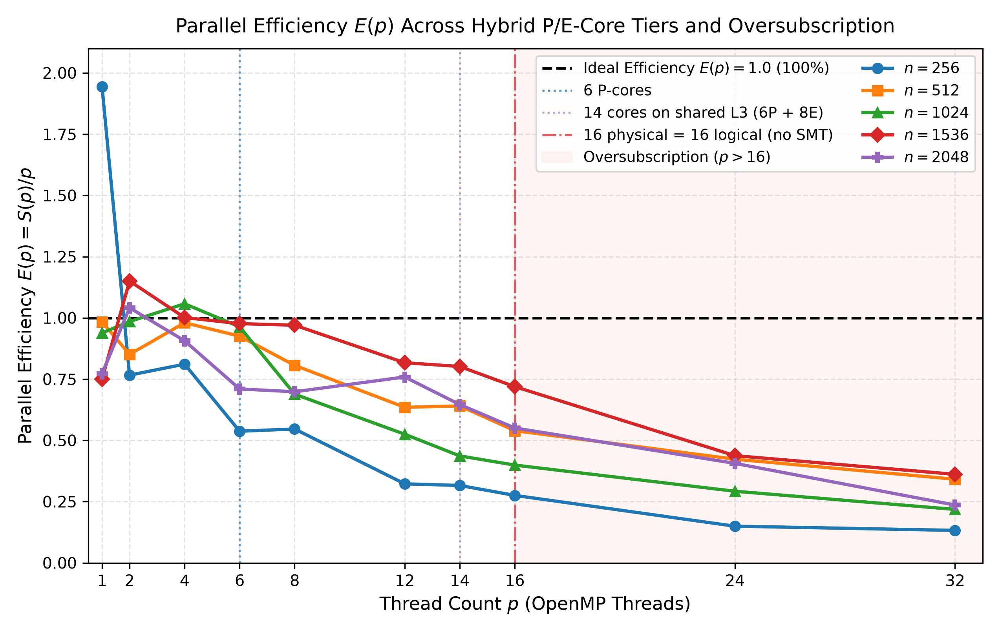
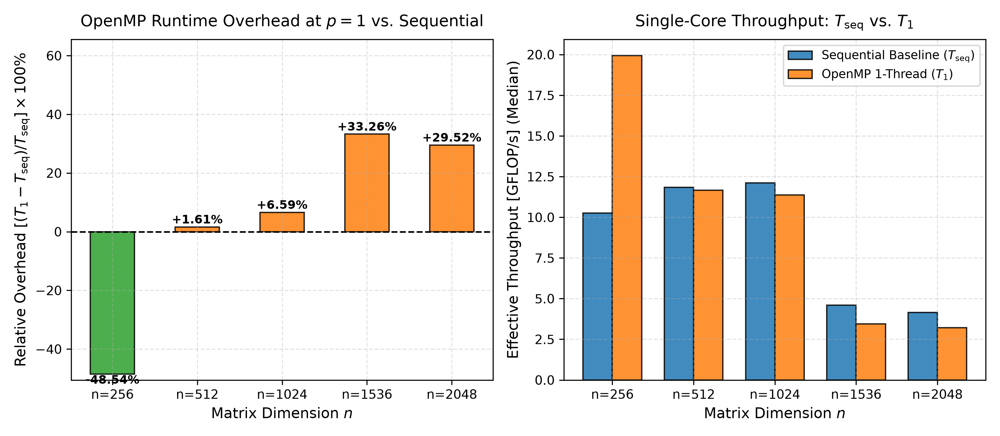
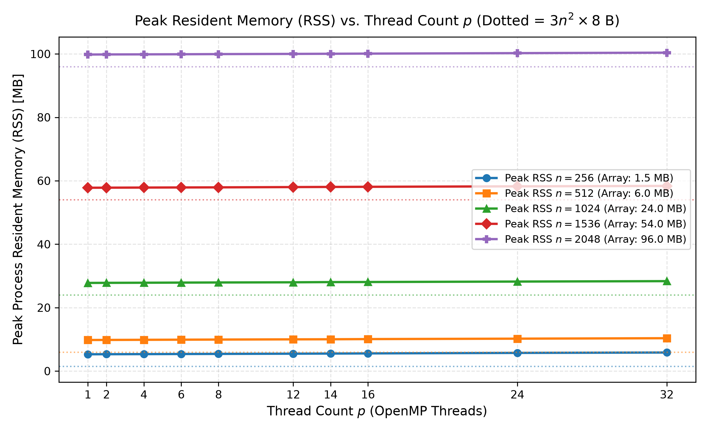
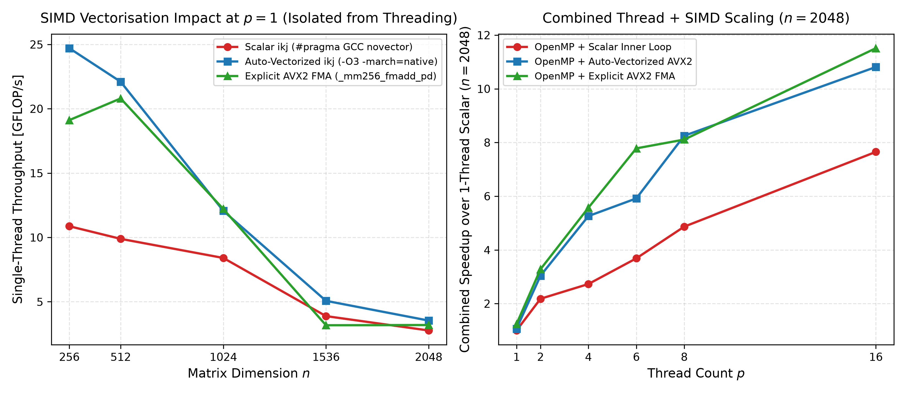

# Assignment 3 — Shared-Memory Parallel Matrix Multiplication (OpenMP) & SIMD Vectorisation


-3B6E8C)
-2E8B57)


-brightgreen)

**Author:** Lucas Rodríguez Hernández  
**Course:** Big Data — Grado en Ciencia e Ingeniería de Datos (ULPGC), Academic Year 2026–2027  
**Repository:** [https://github.com/Luucaaass/Assignment03_LucasRodriguez](https://github.com/Luucaaass/Assignment03_LucasRodriguez)  
**Quick Links:** [PDF Report (`Assignment03_LucasRodriguez_Report.pdf`)](report/Assignment03_LucasRodriguez_Report.pdf) · [Markdown Report (`report/report.md`)](report/report.md) · [Main Summary CSV (`results/summary_metrics.csv`)](results/summary_metrics.csv) · [SIMD Summary CSV (`results/summary_vectorization.csv`)](results/summary_vectorization.csv)

---

## 1. Executive Summary & Headline Results

This study evaluates shared-memory strong scaling and SIMD vectorisation for dense `float64` matrix multiplication ($C = A B$, $n \in \{256, 512, 1024, 1536, 2048\}$) on a 16-core hybrid **Intel® Core™ Ultra 9 285H** processor (6 Lion Cove P-cores + 8 L3-attached Skymont E-cores + 2 low-power E-cores, no SMT, 24 MB shared L3). The row-major `ikj` baseline validated in Assignment 2 (`src/sequential.c`) is compared under identical compilation flags (`-O3 -march=native -std=c11`), 64-byte aligned 1-D memory layout, and IEEE-754 double-precision arithmetic against an OpenMP row-partitioned implementation (`#pragma omp parallel for schedule(static)`, `src/parallel_omp.c`) across $p \in \{1, 2, 4, 6, 8, 12, 14, 16, 24, 32\}$ threads, alongside a controlled SIMD study isolating `#pragma GCC novector` scalar code, compiler auto-vectorised AVX2 (`vmulpd`/`vaddpd`), and explicit 4×-unrolled AVX2 FMA intrinsics (`_mm256_fmadd_pd`).

### Headline Strong-Scaling Summary (`results/summary_metrics.csv`)

| Matrix Size $n$ | Working Set ($3n^2 \cdot 8$ B) & Cache Regime | $T_{\text{seq}}$ [s] (GFLOP/s) | $T_1$ OpenMP [s] (vs. Seq) | 6 P-Core $S(6)$ ($E(6)$) | Best Physical $p^*$ ($\le 16$) | $T_{p^*}$ [s] (Best Physical / Overall) | Peak Speedup $S(p^*)$ (Physical / Overall) | Efficiency $E(p^*)$ (Physical / Overall) | Peak Throughput [GFLOP/s] |
|---:|---|---:|---:|---:|---:|---:|---:|---:|---:|
| **256** | 1,536 KB (1.50 MB, L2-resident) | 0.003271\* (10.26) | 0.001683 (−48.54%\* / +23.9% warm) | 3.22× (53.7%) | $p = 14$ | 0.000740 | 4.42×\* (1.84× warm) | 31.6% | 45.36 ($p=14$) |
| **512** | 6,144 KB (6.00 MB, L2/L3-resident) | 0.022665 (11.84) | 0.023030 (+1.61%) | 5.55× (92.5%) | $p = 14$ (32 ovs.) | 0.002527 / 0.002076 | 8.97× / 10.92× | 64.1% / 34.1% | 106.22 ($p=14$) / 129.34 ($p=32$) |
| **1024** | 24,576 KB (24.00 MB, L3 boundary) | 0.177308 (12.11) | 0.188998 (+6.59%) | 5.78× (96.3%) | $p = 16$ (24 ovs.) | 0.027774 / 0.025281 | 6.38× / 7.01× | 39.9% / 29.2% | 77.32 ($p=16$) / 98.35 (`omp_avx2` $p=16$) |
| **1536** | 55,296 KB (54.00 MB, Out-of-L3) | 1.574048 (4.60) | 2.097520 (+33.26%) | 5.86× (97.6%) | $p = 16$ (32 ovs.) | 0.136787 / 0.136148 | 11.51× / 11.56× | 71.9% / 36.1% | 52.99 ($p=16$) / 53.23 ($p=32$) |
| **2048** | 98,304 KB (96.00 MB, DRAM-bound) | 4.137780 (4.15) | 5.359212 (+29.52%) | 4.26× (71.0%) | $p = 12$ (24 ovs.) | 0.454479 / 0.424607 | 9.10× / 9.74× | 75.9% / 40.6% | 37.80 ($p=12$) / 40.46 ($p=24$) |

*\*Note on $n=256$:* `./sequential.exe 256` runs first in Step 3 (`0.003271 s`, cold DVFS start). Re-running the exact same `./sequential.exe 256` binary in Step 4 (`results/summary_vectorization.csv`) on a warmed-up core records `0.001358 s` (`24.71 GFLOP/s`), showing a true $p=1$ OpenMP overhead of `+23.9%` (`S(1) = 0.81×`).

### Key Architectural Findings

* **L3-to-DRAM Bandwidth Cliff ($n \ge 1536$):** Single-core sequential throughput holds steady at **10.26–12.11 GFLOP/s** while the three matrices fit inside the 24 MB shared L3 + 28 MB L2 hierarchy ($n \le 1024$), then drops by **2.6×** to **4.60 GFLOP/s** ($n = 1536$, 54 MB) and **4.15 GFLOP/s** ($n = 2048$, 96 MB) once matrix $B$ ($18$–$32\text{ MB}$) thrashing evicts rows before reuse.
* **Hybrid Core Tiers & Cooperative Cache Scaling:** Across the 6 P-cores ($p = 6$), efficiency is near-linear (**92.5%–97.6%** for $n \in [512, 1536]$). Beyond $p = 6$, equal-sized `schedule(static)` chunks spill onto slower E-cores, stalling L3-resident scaling at $n = 1024$ ($S(16) = 6.38\times$). For DRAM-bound sizes ($n = 1536, 2048$), however, pooling private L2 caches ($18\text{ MB}$ across 6 P-cores) and sharing $B$ cache lines in L3 yields **$S(16) = 11.51\times$** ($E = 71.9\%$) at $n = 1536$ and **$S(12) = 9.10\times$** ($E = 75.9\%$) at $n = 2048$.
* **Compiler Outlining vs. $p = 1$ OpenMP Overhead:** While 1-thread OpenMP overhead is only **+1.61%** ($n = 512$) and **+6.59%** ($n = 1024$), it rises to **+33.26%** ($n = 1536$) and **+29.52%** ($n = 2048$). Assembly inspection (`results/sequential.s` vs. `results/parallel_omp.s`) shows that outlining into `matmul_parallel_omp_ikj._omp_fn.0` drops outer `restrict` pointer provenance and disables the 2-$k$ outer unroll-and-jam optimization GCC applies to `sequential`.
* **Controlled SIMD Vectorisation & Memory Invariance:** Isolated at $p = 1$, 256-bit AVX2 vectorisation achieves **2.27×** ($n = 256$) and **2.23×** ($n = 512$) speedup over scalar `ikj` in cache, narrowing to **1.28×–1.45×** when DRAM-bandwidth bound ($n \ge 1024$). Combined with 16 OpenMP threads at $n = 1024$, explicit 4×-unrolled AVX2 FMA (`omp_avx2`) reaches **98.35 GFLOP/s** (**11.70×** over 1-thread scalar), while peak RSS grows by at most **800 KB (+0.78%)** from $p = 1$ to $p = 32$.

---

## 2. Visual Performance Gallery

| Execution Time vs. Matrix Size $n$ (Log–Log) | Strong-Scaling Speedup $S(p)$ vs. Thread Count $p$ |
|:---:|:---:|
|  |  |
| **Parallel Efficiency $E(p)$ Across Hybrid Core Tiers** | **OpenMP $p = 1$ Overhead & Single-Core Throughput** |
|  |  |
| **Peak Resident Memory (RSS) vs. Thread Count $p$** | **Controlled SIMD Vectorisation (Scalar vs. AVX2 vs. FMA)** |
|  |  |

---

## 3. Benchmark Environment

| Component | Measured Specification (`results/environment.txt`) |
|---|---|
| **Processor** | Intel® Core™ Ultra 9 285H (Arrow Lake-H, Family 6 Model 197 Stepping 2), 1 socket |
| **Cores / Logical CPUs** | **16 physical cores / 16 logical processors, 0 cores with SMT** (`LTP_PC_SMT = 0`) |
| **Hybrid Core Layout** | **6 P-cores** (`EfficiencyClass 1`, CPUs 0, 1, 10–13) + **10 E-cores** (`EfficiencyClass 0`: 8 L3-attached E-cores on CPUs 2–9 + 2 LP E-cores on CPUs 14–15) |
| **Cache Hierarchy** | **L1d:** 6×48 KB (P) + 10×32 KB (E); **L2:** 6×3 MB (P) + 2×4 MB (E clusters) + 1×2 MB (LP-E pair) = **28 MB**; **L3:** **24 MB** shared by 14 cores (`mask 0x3fff`) |
| **System Memory** | 63.40 GiB usable physical RAM (68,073,553,920 bytes) |
| **Operating System** | Microsoft Windows 11 (build 10.0.26300), 64-bit |
| **Compiler & OpenMP** | GCC 16.2.0 (`x86_64-w64-mingw32`, w64devkit), GNU `libgomp` (`_OPENMP = 202111`, OpenMP 5.2) |
| **Compiler Flags** | `-O3 -march=native -std=c11 -Wall -Wextra` (+ `-fopenmp` for `parallel_omp.exe`); linked with `-lm -lpsapi` |
| **Python Stack** | CPython 3.14.4, `numpy` 2.5.2, `pandas` 3.0.6, `matplotlib` 3.11.2 |

---

## 4. Repository Structure

```text
assignment_03/
├── .gitignore                 # ignores *.exe, *.o, *.zip, and __pycache__/
├── Makefile                   # build, correctness check, vec-report, and clean targets
├── README.md                  # project overview, headline tables, figures, and instructions
├── src/
│   ├── matrix_common.h        # shared declarations, aligned allocation, timers, RSS, verification
│   ├── matrix_common.c        # 64-byte aligned malloc, xorshift64* PRNG, QPC/CPU timers, tolerance checks
│   ├── sequential.c           # sequential ikj baseline (+ seq_scalar and seq_avx2 variants)
│   └── parallel_omp.c         # OpenMP parallel ikj (+ omp_scalar and omp_avx2 variants)
├── scripts/
│   ├── run_correctness.sh     # automated build + pre-benchmark correctness verification suite
│   ├── benchmark_runner.py    # end-to-end compilation, validation, benchmarking, CSV & plot generation
│   ├── plot_results.py        # regenerates all 6 PNG/SVG figures and summary tables from CSVs
│   └── cpu_topology.c         # Win32 GetLogicalProcessorInformationEx hardware topology probe
├── data/
│   ├── raw_measurements.csv   # 275 rows: all timed repetitions (n, impl, numeric_type, p, run)
│   └── raw_vectorization.csv  # 255 rows: controlled SIMD repetitions (scalar vs. auto-AVX2 vs. FMA)
├── results/
│   ├── summary_metrics.csv          # 55 rows: medians, IQRs, S(p), E(p), p=1 overhead, RSS, GFLOP/s
│   ├── summary_vectorization.csv    # 51 rows: SIMD medians, IQRs, SIMD speedups, GFLOP/s
│   ├── correctness_log.txt          # 60/60 passed verification checks (atol = rtol = 1e-9)
│   ├── vectorization_evidence.txt   # GCC -fopt-info-vec-optimized auto-vectorisation report
│   ├── parallel_omp.s               # annotated x86-64 assembly for parallel_omp.c
│   ├── sequential.s                 # annotated x86-64 assembly for sequential.c (2-k unroll-and-jam)
│   ├── environment.txt              # hardware, OS, RAM, and compiler metadata captured at runtime
│   ├── benchmark_console.log        # complete benchmark execution console transcript
│   └── figures/                     # 6 publication-quality charts in both PNG (300 dpi) and SVG formats
└── report/
    ├── report.md                                 # complete 8-section technical report
    └── Assignment03_LucasRodriguez_Report.pdf    # rendered PDF report
```

---

## 5. Reproduction Instructions

All commands run from the repository root with `gcc` (MinGW-w64 / w64devkit or Linux GCC) and Python 3 on `PATH`. On Linux/macOS, the exact same C sources compile unchanged using POSIX `clock_gettime(CLOCK_MONOTONIC)` and `getrusage`.

```bash
# 1) Compile sequential and OpenMP binaries (-O3 -march=native -std=c11 -fopenmp)
make all                       # or: mingw32-make all

# 2) Run the 60-test correctness verification suite (Identity, Zero, Reference ikj/ijk, atol=rtol=1e-9)
make check                     # or: bash scripts/run_correctness.sh

# 3) Run the full experimental suite: build, validate, benchmark, summarize, and plot (~10 min)
python scripts/benchmark_runner.py        # Windows launcher: py scripts/benchmark_runner.py

# 4) Regenerate all figures and summary tables directly from existing CSVs (~3 sec)
python scripts/plot_results.py            # Windows launcher: py scripts/plot_results.py
```

Single configuration invocations (each measured run prints `CSV,n,impl,numeric_type,p,run,kernel_time_sec,peak_rss_kb,cpu_util_pct,checksum` with `numeric_type=float64`):

```bash
./sequential.exe   <n> [warmups=2] [runs=5] [sequential|seq_scalar|seq_avx2]
./parallel_omp.exe <n> <p> [warmups=2] [runs=5] [parallel_omp|omp_scalar|omp_avx2]
```

---

## 6. Known Limitations

1. **Thread Pinning on Windows `libgomp`:** The MinGW-w64 port of GNU `libgomp` (`config/mingw32/proc.c`) does not implement `OMP_PLACES` / `OMP_PROC_BIND` CPU-set binding, so thread placement across P-cores and E-cores is managed dynamically by the Windows 11 scheduler and Intel Thread Director (`OMP_PROC_BIND=false` is set to suppress the unsupported-affinity warning).
2. **Process CPU Utilisation Calibration (`cpu_util_pct`):** CPU time is derived from Win32 `QueryProcessCycleTime` normalized by a startup frequency calibration loop; because Arrow Lake cores scale clock frequency dynamically under sustained AVX2 loads, percentages can slightly exceed $100\% \times p$ and are noisy for sub-millisecond runs ($n = 256$). Unmeasurable intervals (`kernel_time_sec <= 1e-9`) are emitted as `NAN` and never imputed.
3. **Process-Level Peak RSS (`peak_rss_kb`):** Reported via `GetProcessMemoryInfo` (`PeakWorkingSetSize / 1024` on Windows, `getrusage(RUSAGE_SELF).ru_maxrss` on Linux) in a fresh process per $(n, p)$ configuration.
