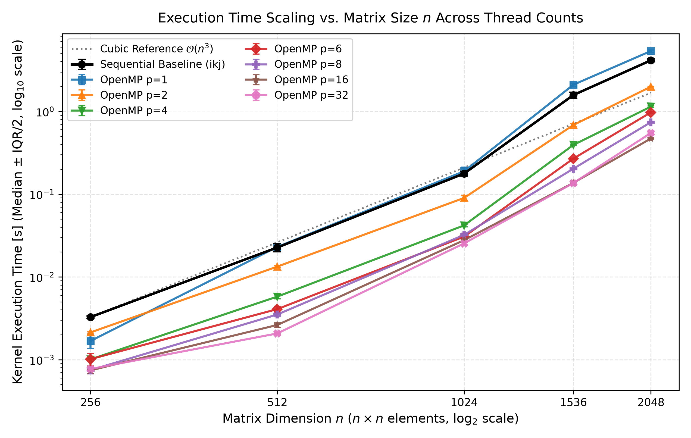
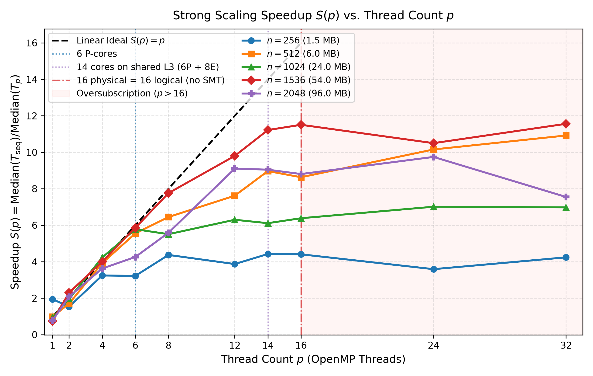
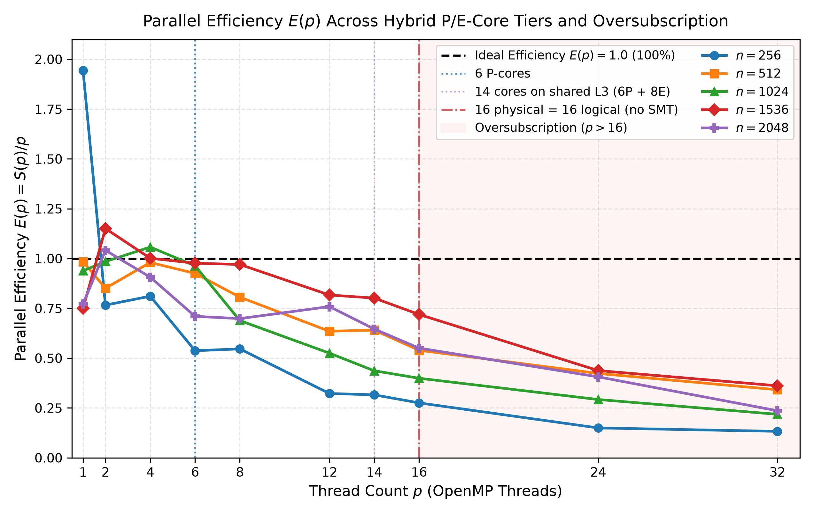
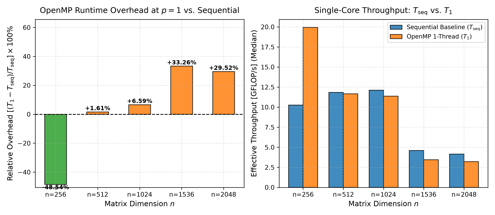
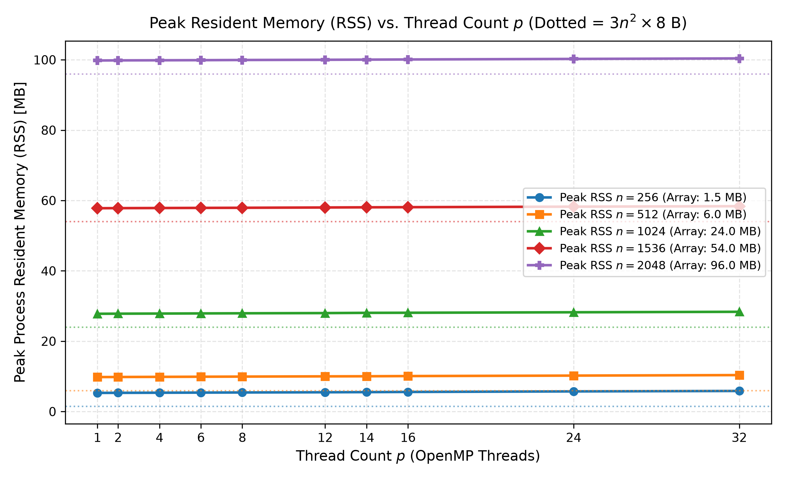
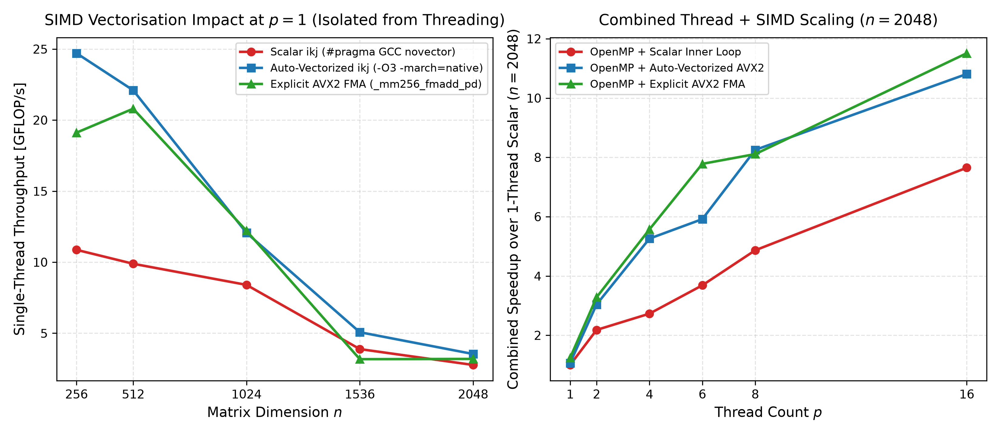

# Individual Assignment 3: Shared-Memory Parallel Matrix Multiplication and SIMD Vectorisation on a Hybrid Multicore Processor

**Author:** Lucas Rodríguez Hernández
**Course:** Big Data — Grado en Ciencia e Ingeniería de Datos, Universidad de Las Palmas de Gran Canaria (ULPGC), Academic Year 2026–2027
**Repository:** [https://github.com/Luucaaass/Assignment03_LucasRodriguez](https://github.com/Luucaaass/Assignment03_LucasRodriguez)

---

## 1. Title and Short Abstract

**Research question.** How does the OpenMP thread count $p \in \{1, 2, 4, 6, 8, 12, 14, 16, 24, 32\}$ affect the kernel execution time, speedup $S(p)$, parallel efficiency $E(p)$, and peak resident memory of dense double-precision matrix multiplication ($n \in \{256, 512, 1024, 1536, 2048\}$) compared against an equivalent sequential `ikj` baseline on a 16-core hybrid processor, and how much of the single- and multi-core throughput comes from SIMD vectorisation rather than thread count?

**Method.** The validated row-major `ikj` kernel from Assignment 2 (`src/benchmark_a2.c`, function `dense_ikj`) is reused unchanged in algorithm, 64-bit IEEE-754 arithmetic, and 1-D contiguous layout (`src/sequential.c`), and parallelised across the outer row loop with `#pragma omp parallel for schedule(static)` (`src/parallel_omp.c`). Both binaries are compiled with GCC 16.2.0 (MinGW-w64) using `-O3 -march=native -std=c11` (plus `-fopenmp`, OpenMP 5.2) and executed on an Intel Core Ultra 9 285H (16 physical cores / 16 logical processors, no SMT: 6 P-cores + 8 L3-attached E-cores + 2 low-power E-cores; 24 MB shared L3; 63.40 GiB RAM; Windows 11). Each $(n, p)$ configuration runs in a fresh process with 2 untimed warm-ups and 5 timed repetitions of the isolated multiplication kernel (including zero-initialisation of $C$). A separate controlled experiment compares `#pragma GCC novector` scalar loops, compiler auto-vectorised AVX2 loops (`vmulpd`/`vaddpd`), and explicit 4×-unrolled AVX2 FMA intrinsics (`vfmadd213pd`).

**Main quantitative findings.** Across the 6 P-cores ($p = 6$), median speedup reaches $S(6) = 5.55\times$ ($E = 92.5\%$) at $n = 512$, $5.78\times$ ($E = 96.3\%$, 70.01 GFLOP/s) at $n = 1024$, and $5.86\times$ ($E = 97.6\%$) at $n = 1536$. Once $p > 6$ recruits slower E-cores under `schedule(static)`, equal row chunks become load-imbalanced: at $n = 1024$ (24 MB working set fitting in the 24 MB L3), $S(p)$ plateaus at $6.38\times$ ($p = 16$, $E = 39.9\%$). For out-of-L3 problems ($n = 1536$, 54 MB; $n = 2048$, 96 MB), adding threads aggregates private L2 capacity and shares DRAM-fetched rows of $B$ in L3, giving $S(16) = 11.51\times$ ($E = 71.9\%$) at $n = 1536$ and $S(12) = 9.10\times$ ($E = 75.9\%$) at $n = 2048$. Oversubscription at $p = 32$ ($2\times$ logical processors) reduces $n = 2048$ speedup from $8.81\times$ ($p = 16$) to $7.55\times$ ($E = 23.6\%$). At $p = 1$, OpenMP overhead is $+1.61\%$ ($n = 512$) and $+6.59\%$ ($n = 1024$), rising to $+33.26\%$ ($n = 1536$) and $+29.52\%$ ($n = 2048$) because OpenMP outlining (`matmul_parallel_omp_ikj._omp_fn.0`) drops the outer `restrict` qualifier and suppresses outer-loop unroll-and-jam. Peak RSS is invariant with $p$, growing by at most 800 KB (+0.78% at $n = 2048$) from $p = 1$ to $p = 32$. Isolated at $p = 1$, compiler AVX2 vectorisation speeds up the scalar `ikj` loop by $2.27\times$ ($n = 256$), $2.23\times$ ($n = 512$), $1.44\times$ ($n = 1024$), $1.31\times$ ($n = 1536$), and $1.28\times$ ($n = 2048$); combined with 16 threads at $n = 1024$, explicit AVX2 FMA reaches 98.35 GFLOP/s ($11.70\times$ over 1-thread scalar).

**Scope.** Conclusions apply to dense row-major `float64` `ikj` multiplication compiled with GCC 16.2.0 / libgomp on this hybrid x86-64 Windows 11 host, where `libgomp` does not support thread-to-core pinning.

---

## 2. Introduction and Objective

Dense matrix multiplication $C = A B$ for $A, B, C \in \mathbb{R}^{n \times n}$ performs $2n^3$ floating-point operations over $3n^2$ words of data. In Assignment 2, reordering the sequential triple loop from `ijk` to `ikj` yielded an $8.69\times$ speedup at $n = 1024$ by turning the inner loop into a unit-stride update `c_row[j] += a_ik * b_row[j]` [1], [2]. On a single core, however, runtime still grows cubically with $n$ and degrades sharply once the three matrices exceed the last-level cache. Shared-memory parallelism addresses both limits by partitioning independent output rows across hardware threads that share a single address space.

This study extends the validated sequential `ikj` baseline from Assignment 2 to shared-memory execution with OpenMP and evaluates SIMD vectorisation separately. It addresses three research questions:

1. **RQ1 (Thread scaling across a hybrid multicore hierarchy).** How do kernel runtime $T_p(n)$, speedup $S(p) = T_{\text{seq}}(n)/T_p(n)$, parallel efficiency $E(p) = S(p)/p$, and peak resident memory vary with thread count $p \in \{1, 2, 4, 6, 8, 12, 14, 16, 24, 32\}$ across matrix sizes $n \in \{256, 512, 1024, 1536, 2048\}$ that span L2-resident, L3-resident, and DRAM-bound working sets?
   * **Hypothesis $H_1$.** For $p \le 6$ (the 6 Performance cores), $S(p)$ will scale nearly linearly ($E(p) \ge 0.85$) once $n \ge 512$ amortises barrier cost. For $6 < p \le 16$, efficiency will drop because `schedule(static)` assigns equal row counts to slower Efficient cores. For $p > 16$ (oversubscription beyond the 16 hardware execution contexts), $S(p)$ will plateau or regress while $E(p)$ falls roughly as $1/p$.
2. **RQ2 (Framework and outlining overhead at $p = 1$).** What is the runtime and memory difference between the sequential baseline $T_{\text{seq}}(n)$ and the OpenMP implementation executed with a single thread $T_1(n)$?
   * **Hypothesis $H_2$.** At $p = 1$, $T_1(n) \ge T_{\text{seq}}(n)$ due to OpenMP parallel-region dispatch and any code-generation differences caused by outlining the loop body into `._omp_fn.0`; peak RSS will differ only by the `libgomp` runtime footprint (a few hundred kilobytes).
3. **RQ3 (Optional extension — SIMD vectorisation isolated from thread count).** Under controlled conditions at fixed $p$, how much speedup do 256-bit AVX2 vectorisation (compiler auto-vectorised `vmulpd`/`vaddpd` and explicit FMA `_mm256_fmadd_pd`) provide over a non-vectorised scalar `ikj` loop, and how does the SIMD gain interact with thread scaling and cache residency?
   * **Hypothesis $H_3$.** With 4 `double` lanes per 256-bit YMM register, SIMD will yield a $2\times$–$3\times$ speedup when the working set fits in L1/L2 ($n \le 512$), narrowing toward $1.2\times$–$1.5\times$ once execution becomes L3- or DRAM-bandwidth bound ($n \ge 1024$).

---

## 3. Background and References

### 3.1 Row-major `ikj` kernel and cache traffic

In C's row-major layout, element $(i, j)$ of an $n \times n$ matrix of 8-byte `double` values resides at byte offset $8(i n + j)$, and each 64-byte cache line holds 8 consecutive elements of a row [1], [2]. The `ikj` loop order used by both implementations is:

```c
for (int i = 0; i < n; i++) {               /* parallelised in parallel_omp.c */
    double *c_row = &C[(long)i * n];
    for (int j = 0; j < n; j++) c_row[j] = 0.0;
    for (int k = 0; k < n; k++) {
        const double  a_ik  = A[(long)i * n + k];
        const double *b_row = &B[(long)k * n];
        for (int j = 0; j < n; j++)          /* unit stride, vectorisable */
            c_row[j] += a_ik * b_row[j];
    }
}
```

In this loop nest, the scalar $a_{i,k}$ is invariant across the $j$ loop, while `b_row[j]` and `c_row[j]` are traversed with unit stride. Every 64-byte line fetched from $B$ or $C$ is fully consumed before eviction [2], [3]. However, for each outer index $i$, the middle loop streams through all $n^2$ entries of $B$ ($8n^2$ bytes). When $8n^2$ exceeds the capacity of a cache level under pseudo-LRU replacement, row $B_{0,\cdot}$ is evicted before iteration $i + 1$ begins, so $B$ is re-read from the next level of the hierarchy $n$ times.

### 3.2 Shared-memory parallelism with OpenMP and static scheduling

OpenMP uses a fork–join execution model [4], [5]: a master thread enters `#pragma omp parallel for schedule(static) num_threads(p)`, wakes a team of $p - 1$ worker threads from a persistent pool, partitions the iteration space $i \in [0, n)$ into $p$ contiguous blocks of $\lfloor n/p \rfloor$ or $\lceil n/p \rceil$ rows, and synchronises at an implicit barrier at the end of the loop. Each thread owns a disjoint set of output rows $C_{i,\cdot}$ while $A$ and $B$ are read-only, so the kernel is data-race free without locks or atomic operations. Because row $i$ occupies $8n$ bytes and we test $n \ge 256$ ($8n \ge 2048$ bytes $= 32$ cache lines, aligned to 64 bytes), adjacent threads never write to the same 64-byte cache line, eliminating false sharing [1], [2].

### 3.3 Scaling limits: Amdahl's law, hybrid cores, and the Roofline model

Under Amdahl's law [6], if a fraction $1 - f$ of the execution is serial or synchronisation overhead, speedup on $p$ identical processors is bounded by $S(p) \le 1 / ((1 - f) + f/p)$. On modern processors two additional effects govern $S(p)$:

* **Heterogeneous core speeds under static scheduling.** When $p$ threads are given equal row counts $n/p$ on a processor mixing fast P-cores (rate $r_{\text{P}}$) and slower E-cores (rate $r_{\text{E}} < r_{\text{P}}$), the barrier time is set by the slowest thread, bounding efficiency by $r_{\text{E}} / r_{\text{P}}$ once any thread runs on an E-core.
* **Memory-bandwidth saturation and aggregate cache capacity (Roofline model [7]).** Each inner-loop iteration performs 2 FLOPs (one multiply, one add) and, if $c_{i,j}$ stays in L1/L2 while $b_{k,j}$ misses in L3, streams 8 bytes from DRAM, giving an arithmetic intensity of $2 / 8 = 0.25$ FLOP/byte—well below the ridge point of DDR5/LPDDR5x memory ($\sim 1$–$2$ FLOP/byte). Conversely, when $p$ threads run concurrently, their private L2 caches sum to a larger aggregate capacity and they scan the same rows $B_{k,\cdot}$ at the same time in the shared L3, which can reduce per-row DRAM traffic and produce superlinear speedup over a single cache-thrashing thread [1], [7].

### 3.4 SIMD vectorisation and IEEE-754 fused multiply-add

With 256-bit AVX2 registers (`ymm0`–`ymm15`), one vector instruction operates on four 64-bit `double` lanes simultaneously [1], [8]. A loop vectorized with separate `vmulpd` and `vaddpd` rounds the product $a_{i,k} b_{k,j}$ to 53 significand bits and then rounds the sum, matching scalar IEEE-754 evaluation order bit-for-bit. An explicit fused multiply-add instruction (`vfmadd213pd`, computing $\text{rn}(a_{i,k} b_{k,j} + c_{i,j})$ with a single rounding of the exact 106-bit product) halves instruction count and improves accuracy, at the cost of $O(n u)$ rounding differences ($u = 2^{-53} \approx 1.11 \times 10^{-16}$) relative to unfused evaluation [8].

---

## 4. Methodology

### 4.1 Hardware and software environment

All measurements were collected on a single host; hardware topology was queried directly via the Win32 `GetLogicalProcessorInformationEx` API (`scripts/cpu_topology.c`) and saved in `results/environment.txt`:

| Component | Measured specification |
|---|---|
| Processor | Intel® Core™ Ultra 9 285H (Arrow Lake-H, Family 6 Model 197 Stepping 2), 1 socket |
| Physical / logical cores | **16 physical cores, 16 logical processors, 0 cores with SMT** (`LTP_PC_SMT = 0` on all 16 cores) |
| Hybrid core tiers | **6 P-cores** (`EfficiencyClass 1`: logical CPUs 0, 1, 10, 11, 12, 13) + **10 E-cores** (`EfficiencyClass 0`: 8 E-cores on logical CPUs 2–9 + 2 low-power E-cores on logical CPUs 14–15) |
| L1 caches (64 B line) | P-cores: 6 × 48 KB L1d + 6 × 64 KB L1i; E-cores: 10 × 32 KB L1d + 10 × 64 KB L1i |
| L2 caches (64 B line) | P-cores: 6 × 3072 KB (3 MB private per P-core, 18 MB total); E-cores: 2 × 4096 KB (4 MB per 4-core cluster, `mask 0x3c` and `mask 0x3c0`) + 1 × 2048 KB (2 MB for the LP-E pair, `mask 0xc000`); total L2 = 28 MB |
| L3 cache (64 B line) | 24576 KB (24 MB) unified, `mask 0x3fff` (shared by the 6 P-cores and 8 E-cores = 14 cores; the 2 LP-E cores on `mask 0xc000` are outside the L3 domain) |
| System memory | 63.40 GiB usable physical RAM (68,073,553,920 bytes) |
| Operating system | Microsoft Windows 11 (build 10.0.26300, 64-bit) |
| C compiler & OpenMP | GCC 16.2.0 (`x86_64-w64-mingw32`, w64devkit), GNU `libgomp` with `_OPENMP = 202111` (OpenMP 5.2) |
| Compiler flags | `-O3 -march=native -std=c11 -Wall -Wextra` (plus `-fopenmp` for `parallel_omp.exe`), linked with `-lm -lpsapi`; `-march=native` resolves to `-march=arrowlake -mtune=arrowlake` with `-mavx2 -mfma` |
| External thread controls | No BLAS/MKL library is linked; `OPENBLAS_NUM_THREADS=1`, `MKL_NUM_THREADS=1`, `OMP_DYNAMIC=FALSE` set in the harness |

### 4.2 Implementations under comparison

All implementations share `src/matrix_common.c` and use 64-byte aligned (`_aligned_malloc(..., 64)`) contiguous 1-D arrays of `double` (`sizeof(double) = 8`) in row-major order:

1. **`sequential` (`src/sequential.c`, `matmul_sequential_ikj`).** The equivalent sequential baseline, reusing the `dense_ikj` kernel validated in Assignment 2. For each row $i$, it zeroes `c_row[0..n-1]` and accumulates `c_row[j] += a_ik * b_row[j]`.
2. **`parallel_omp` (`src/parallel_omp.c`, `matmul_parallel_omp_ikj`).** The identical C loop body with `#pragma omp parallel for schedule(static) num_threads(num_threads)` on the outer `i` loop.
3. **Controlled SIMD variants (optional extension).**
   * `seq_scalar` and `omp_scalar`: identical `ikj` code with `#pragma GCC novector` on the inner $j$ loops, forcing scalar `vmulsd`/`vaddsd` (8 bytes/iteration).
   * `sequential` and `parallel_omp`: auto-vectorised by GCC at `-O3 -march=native` using 256-bit `vmulpd`/`vaddpd` (32 bytes/iteration; see Section 6.5 for why `-std=c11` does not contract to FMA).
   * `seq_avx2` and `omp_avx2`: explicit 256-bit AVX2 intrinsics (`_mm256_loadu_pd`, `_mm256_fmadd_pd`, `_mm256_storeu_pd`) unrolled across 4 independent YMM accumulators (`jj += 16`, 128 bytes/iteration) with a 4-wide (`jj += 4`) and scalar cleanup tail.

### 4.3 Timing boundary, inputs, repetition protocol, and budgets

* **Timed region.** The timer brackets **only** the `matmul_*` call. Zero-initialisation of $C$ (`for (j = 0; j < n; j++) c_row[j] = 0.0`) is **inside** the timed kernel in both sequential and parallel implementations (so it is parallelised across rows in `parallel_omp`, giving first-touch locality per thread). Matrix allocation (`alloc_matrix`), deterministic initialization (`generate_random_matrix`), checksum consumption (`compute_checksum`), and RSS measurement (`get_peak_rss_kb`) are strictly **outside** the timed window.
* **Wall-clock timer.** Both binaries call `get_wall_time_sec()` (`QueryPerformanceCounter` / `QueryPerformanceFrequency` on Windows, `clock_gettime(CLOCK_MONOTONIC)` on POSIX), providing $100\text{ ns}$ resolution. (`omp_get_wtime()` was inspected and rejected after we observed $1\text{ ms}$ tick quantisation in the MinGW-w64 build of `libgomp`.)
* **Inputs.** Matrices $A$ and $B$ are filled with uniform pseudo-random `double` values in $[-1, 1]$ using the same 64-bit `xorshift64*` generator as Assignment 2 with deterministic per-size seeds (`seed_A = 42 + n`, `seed_B = 1042 + n`), guaranteeing identical logical inputs across every $(n, p)$ and variant.
* **Experimental grid and budgets.** Prior to benchmarking, we declared a per-configuration time budget of $60\text{ s}$ and a memory budget of $1\text{ GiB}$. All tested sizes $n \in \{256, 512, 1024, 1536, 2048\}$ completed within budget (largest tested size = largest attempted size = $2048$, requiring $3 \times 2048^2 \times 8\text{ B} = 96.00\text{ MiB}$ for the three arrays and $\le 100.39\text{ MiB}$ peak RSS; zero timeouts or memory failures). Thread counts are $p \in \{1, 2, 4, 6, 8, 12, 14, 16, 24, 32\}$, covering 1 thread, the 6-P-core boundary, the 14-core shared-L3 boundary, all 16 physical/logical cores, and two oversubscription points ($1.5\times$ and $2\times$ logical processors).
* **Warm-up and repetitions.** Each $(n, p)$ runs in a separate OS process executing 2 untimed warm-up calls (priming caches and the `libgomp` thread pool) followed by 5 timed repetitions. All 275 main measurements (`data/raw_measurements.csv`) and 255 SIMD measurements (`data/raw_vectorization.csv`) are retained without exclusions; every row is labelled with matrix size, implementation, numeric type (`float64`), thread count, and repetition index. Central tendency is the **median** of the 5 runs and variability is the **interquartile range** $\text{IQR} = Q_{75} - Q_{25}$; $S(p)$ and $E(p)$ are defined from medians.
* **Short kernels at $n = 256$ and batching.** The course guideline (page 2 of the assignment specification) states that *"Very short tasks may require repeated batches with a clearly reported time per multiplication."* At $n = 256$, the kernel is sub-millisecond for $p \ge 8$ (median $0.74$–$0.91\text{ ms}$, fastest single run $0.52\text{ ms}$ at $p = 24$). Each timed repetition is exactly **one** multiplication, so every reported value in `kernel_time_sec` is already a time per multiplication (no division by a batch count is involved). Even the fastest run spans $\approx 5\,200$ ticks of the $100\text{ ns}$ `QueryPerformanceCounter` timer, bounding quantisation error below $0.02\%$, so timer resolution did not force batching. The dominant error source at this scale is instead run-to-run noise from frequency ramp-up and thread wake-up (e.g. IQR/median up to $38\%$ for `parallel_omp` $p = 1$). For this reason, the $n = 256$ **thread-scaling** values ($S(p)$, $E(p)$ in Tables 1–2) are treated as indicative only and are not used to support the scaling conclusions in Section 7. The single-thread SIMD comparison at $n = 256$ (Table 3) is retained because both kernels exceed $1\text{ ms}$ and are stable ($3.087\text{ ms}$ scalar, IQR $4.5\%$ of median; $1.358\text{ ms}$ auto-vectorised, IQR $1.4\%$). A batched protocol (timing $B$ back-to-back multiplications and reporting $T_{\text{batch}}/B$) is the recommended refinement for this size.

### 4.4 Correctness verification and floating-point tolerances

Before any timed run, `benchmark_runner.py` invokes `sequential.exe --check` and `parallel_omp.exe --check` (`results/correctness_log.txt`), testing $n \in \{16, 64, 67, 128\}$ (including the non-power-of-two size $n = 67$ to exercise cleanup tails) across $p \in \{1, 2, 4, 8, 16, 32\}$. Each check verifies:

1. **Identity:** $A I = A$.
2. **Zero:** $A \cdot 0 = 0$.
3. **Reference agreement:** $|y - \hat{y}| \le \text{atol} + \text{rtol}\cdot|\hat{y}|$ against the naive `ijk` and sequential `ikj` references with $\text{atol} = \text{rtol} = 10^{-9}$.

All 60 checks pass. Notably, `sequential`, `seq_scalar`, `parallel_omp` (for every $p$), and `omp_scalar` achieve **exact bit-wise agreement** (`max_abs_err = 0.000e+00`) with the reference because `ikj` sums along $k$ in the exact same order $k = 0, \ldots, n-1$ for every entry $C_{i,j}$ regardless of outer-loop thread partitioning or 4-lane `vmulpd`/`vaddpd` vectorisation. By contrast, `seq_avx2` and `omp_avx2` show `max_abs_err` of $8.882 \times 10^{-16}$ ($n = 16$), $3.553 \times 10^{-15}$ ($n = 64$), $2.665 \times 10^{-15}$ ($n = 67$), and $6.217 \times 10^{-15}$ ($n = 128$)—within $\le 56\,u$ of machine epsilon ($u = 2^{-53} \approx 1.11 \times 10^{-16}$) and seven orders of magnitude below the $10^{-9}$ tolerance—because `_mm256_fmadd_pd` emits `vfmadd213pd`, which performs a single rounding per multiply-add instead of two.

### 4.5 Memory and CPU-utilisation metrics and measurement limitations

* **Peak RSS (`peak_rss_kb`).** Queried after each kernel execution via Win32 `GetProcessMemoryInfo` (`PeakWorkingSetSize / 1024`, the Windows counterpart of `getrusage(RUSAGE_SELF).ru_maxrss`). Because `PeakWorkingSetSize` is a monotonic high-water mark per process and each $(n, p)$ configuration runs in its own process, it accurately captures the per-configuration peak resident footprint, including executable pages, CRT heap, and `libgomp` thread stacks.
* **Thread affinity limitation on Windows `libgomp`.** Running `parallel_omp.exe` with `OMP_PROC_BIND=true OMP_PLACES=cores OMP_DISPLAY_ENV=VERBOSE` prints `libgomp: Affinity not supported on this configuration` and reports `affinity 0-15` for every thread. The MinGW-w64 port of `libgomp` compiles with `config/mingw32/proc.c`, which does not implement CPU-set binding. Thread placement across P-cores and E-cores is therefore governed by the Windows 11 scheduler and Intel Thread Director; we set `OMP_PROC_BIND=false` in the benchmark harness, in the correctness step of `benchmark_runner.py`, and in `scripts/run_correctness.sh`, so neither the benchmarks nor `make check` trigger the warning.
* **CPU utilisation (`cpu_util_pct`) limitation.** Process CPU time is estimated by reading `QueryProcessCycleTime` before and after the kernel and dividing by a startup cycle-per-second calibration (`calibrate_cpu_cycles` in `src/matrix_common.c`). Because Intel Arrow Lake cores scale frequency dynamically between the short calibration loop and sustained AVX2 workloads (and between P- and E-cores), the ratio $(t_{\text{CPU}} / t_{\text{wall}}) \times 100\%$ can slightly exceed $100\% \times p$ (e.g. $102\%$–$121\%$ at $p = 1$) and is noisy for sub-millisecond runs ($n = 256$). In strict compliance with the course policy against fabricated data, no clamping or fallback value is applied; if `kernel_time_sec <= 1e-9`, `NAN` is emitted.

---

## 5. Results

### 5.1 Main strong-scaling results (Sequential vs. OpenMP)

Table 1 reports the complete summary statistics (5 measured repetitions per cell after 2 warm-ups) from `results/summary_metrics.csv`. Table 2 gives a compact cross-size matrix of median runtime $T_p(n)$, speedup $S(p)$, and parallel efficiency $E(p)$. Note on $n = 256$: because `./sequential.exe 256 2 5 sequential` is the very first process executed in the Step 3 benchmark sweep, its 7 total calls ($\approx 23\text{ ms}$ cumulative CPU time) execute before the processor completes DVFS Turbo frequency ramp-up, recording a cold-start median of $3.271\text{ ms}$ ($10.26\text{ GFLOP/s}$). When the exact same `./sequential.exe 256 2 5 sequential` command is re-executed in Step 4 (Table 3, `results/summary_vectorization.csv`) with the CPU already at sustained Turbo frequency, its median time drops to $1.358\text{ ms}$ ($24.71\text{ GFLOP/s}$, $\text{IQR} = 0.019\text{ ms}$). Relative to that warm sequential baseline ($1.358\text{ ms}$), `parallel_omp` at $p = 1$ ($1.683\text{ ms}$) exhibits an actual single-thread OpenMP overhead of $+23.9\%$ ($S(1) = 0.81\times$), proving that the apparent $S(1) = 1.94\times$ ($-48.54\%$) in Table 1 is a cold-start DVFS artifact rather than a true single-thread speedup (see Sections 6.2–6.4).

**Table 1.** Complete strong-scaling performance and memory summary across $n \in \{256, 512, 1024, 1536, 2048\}$ and $p \in \{1, 2, 4, 6, 8, 12, 14, 16, 24, 32\}$ (5 repetitions per row; numeric type `float64` in every row; IQR of Peak RSS is 0 KB in all rows). Method: `seq` = `sequential`, `omp` = `parallel_omp`. Array [KB] = theoretical storage of the three matrices, 3n²·8 B / 1024. vs Seq [%] = (T_p − T_seq)/T_seq × 100.

| Size n | Method | p | Median [s] | IQR [s] | S(p) | E(p) [%] | vs Seq [%] | GFLOP/s | Array [KB] | Peak RSS [KB] | CPU [%] |
|---:|---|---:|---:|---:|---:|---:|---:|---:|---:|---:|---:|
| 256 | `seq` | 1 | 0.003271 | 0.000179 | 1.00× | 100.0 | +0.00 | 10.26 | 1536 | 5240 | 109.9 |
| 256 | `omp` | 1 | 0.001683 | 0.000634 | 1.94× | 194.3 | −48.54 | 19.93 | 1536 | 5428 | 121.3 |
| 256 | `omp` | 2 | 0.002135 | 0.000070 | 1.53× | 76.6 | −34.72 | 15.71 | 1536 | 5448 | 200.0 |
| 256 | `omp` | 4 | 0.001008 | 0.000019 | 3.24× | 81.1 | −69.17 | 33.27 | 1536 | 5480 | 344.3 |
| 256 | `omp` | 6 | 0.001015 | 0.000346 | 3.22× | 53.7 | −68.97 | 33.06 | 1536 | 5516 | 393.2 |
| 256 | `omp` | 8 | 0.000748 | 0.000149 | 4.37× | 54.6 | −77.12 | 44.83 | 1536 | 5552 | 482.8 |
| 256 | `omp` | 12 | 0.000845 | 0.000153 | 3.87× | 32.3 | −74.16 | 39.70 | 1536 | 5616 | 502.8 |
| 256 | `omp` | 14 | 0.000740 | 0.000209 | 4.42× | 31.6 | −77.38 | 45.36 | 1536 | 5656 | 637.7 |
| 256 | `omp` | 16 | 0.000743 | 0.000127 | 4.40× | 27.5 | −77.30 | 45.18 | 1536 | 5708 | 665.8 |
| 256 | `omp` | 24 | 0.000911 | 0.000262 | 3.59× | 15.0 | −72.14 | 36.82 | 1536 | 5868 | 491.3 |
| 256 | `omp` | 32 | 0.000772 | 0.000083 | 4.24× | 13.2 | −76.41 | 43.48 | 1536 | 5992 | 555.9 |
| 512 | `seq` | 1 | 0.022665 | 0.005062 | 1.00× | 100.0 | +0.00 | 11.84 | 6144 | 9844 | 102.4 |
| 512 | `omp` | 1 | 0.023030 | 0.004289 | 0.98× | 98.4 | +1.61 | 11.66 | 6144 | 10036 | 102.4 |
| 512 | `omp` | 2 | 0.013320 | 0.000699 | 1.70× | 85.1 | −41.23 | 20.15 | 6144 | 10056 | 201.6 |
| 512 | `omp` | 4 | 0.005782 | 0.000673 | 3.92× | 98.0 | −74.49 | 46.43 | 6144 | 10096 | 348.7 |
| 512 | `omp` | 6 | 0.004082 | 0.000671 | 5.55× | 92.5 | −81.99 | 65.75 | 6144 | 10136 | 417.4 |
| 512 | `omp` | 8 | 0.003514 | 0.000415 | 6.45× | 80.6 | −84.49 | 76.38 | 6144 | 10176 | 517.5 |
| 512 | `omp` | 12 | 0.002975 | 0.000097 | 7.62× | 63.5 | −86.87 | 90.23 | 6144 | 10244 | 694.1 |
| 512 | `omp` | 14 | 0.002527 | 0.000035 | 8.97× | 64.1 | −88.85 | 106.22 | 6144 | 10272 | 750.2 |
| 512 | `omp` | 16 | 0.002626 | 0.000331 | 8.63× | 53.9 | −88.41 | 102.22 | 6144 | 10328 | 840.2 |
| 512 | `omp` | 24 | 0.002232 | 0.000479 | 10.15× | 42.3 | −90.15 | 120.26 | 6144 | 10464 | 965.6 |
| 512 | `omp` | 32 | 0.002076 | 0.000068 | 10.92× | 34.1 | −90.84 | 129.34 | 6144 | 10612 | 1094.0 |
| 1024 | `seq` | 1 | 0.177308 | 0.023668 | 1.00× | 100.0 | +0.00 | 12.11 | 24576 | 28280 | 106.0 |
| 1024 | `omp` | 1 | 0.188998 | 0.045857 | 0.94× | 93.8 | +6.59 | 11.36 | 24576 | 28464 | 106.2 |
| 1024 | `omp` | 2 | 0.090011 | 0.012096 | 1.97× | 98.5 | −49.23 | 23.86 | 24576 | 28488 | 195.9 |
| 1024 | `omp` | 4 | 0.041920 | 0.003119 | 4.23× | 105.7 | −76.36 | 51.23 | 24576 | 28524 | 381.3 |
| 1024 | `omp` | 6 | 0.030673 | 0.000429 | 5.78× | 96.3 | −82.70 | 70.01 | 24576 | 28568 | 562.4 |
| 1024 | `omp` | 8 | 0.032194 | 0.003228 | 5.51× | 68.8 | −81.84 | 66.70 | 24576 | 28604 | 654.0 |
| 1024 | `omp` | 12 | 0.028147 | 0.002258 | 6.30× | 52.5 | −84.13 | 76.29 | 24576 | 28664 | 884.0 |
| 1024 | `omp` | 14 | 0.029012 | 0.003614 | 6.11× | 43.7 | −83.64 | 74.02 | 24576 | 28732 | 949.7 |
| 1024 | `omp` | 16 | 0.027774 | 0.003204 | 6.38× | 39.9 | −84.34 | 77.32 | 24576 | 28756 | 955.6 |
| 1024 | `omp` | 24 | 0.025281 | 0.001796 | 7.01× | 29.2 | −85.74 | 84.94 | 24576 | 28900 | 1036.1 |
| 1024 | `omp` | 32 | 0.025408 | 0.001281 | 6.98× | 21.8 | −85.67 | 84.52 | 24576 | 29036 | 1111.1 |
| 1536 | `seq` | 1 | 1.574048 | 0.281470 | 1.00× | 100.0 | +0.00 | 4.60 | 55296 | 58996 | 104.9 |
| 1536 | `omp` | 1 | 2.097520 | 0.200118 | 0.75× | 75.0 | +33.26 | 3.46 | 55296 | 59188 | 105.7 |
| 1536 | `omp` | 2 | 0.684178 | 0.055052 | 2.30× | 115.0 | −56.53 | 10.59 | 55296 | 59212 | 206.4 |
| 1536 | `omp` | 4 | 0.393039 | 0.012310 | 4.00× | 100.1 | −75.03 | 18.44 | 55296 | 59248 | 407.1 |
| 1536 | `omp` | 6 | 0.268688 | 0.007397 | 5.86× | 97.6 | −82.93 | 26.97 | 55296 | 59284 | 600.8 |
| 1536 | `omp` | 8 | 0.202833 | 0.001988 | 7.76× | 97.0 | −87.11 | 35.73 | 55296 | 59316 | 803.8 |
| 1536 | `omp` | 12 | 0.160590 | 0.014169 | 9.80× | 81.7 | −89.80 | 45.13 | 55296 | 59404 | 1111.5 |
| 1536 | `omp` | 14 | 0.140293 | 0.013286 | 11.22× | 80.1 | −91.09 | 51.66 | 55296 | 59452 | 1082.0 |
| 1536 | `omp` | 16 | 0.136787 | 0.016887 | 11.51× | 71.9 | −91.31 | 52.99 | 55296 | 59492 | 1114.5 |
| 1536 | `omp` | 24 | 0.149910 | 0.006767 | 10.50× | 43.7 | −90.48 | 48.35 | 55296 | 59644 | 1023.7 |
| 1536 | `omp` | 32 | 0.136148 | 0.004087 | 11.56× | 36.1 | −91.35 | 53.23 | 55296 | 59776 | 1154.4 |
| 2048 | `seq` | 1 | 4.137780 | 0.364532 | 1.00× | 100.0 | +0.00 | 4.15 | 98304 | 102000 | 96.4 |
| 2048 | `omp` | 1 | 5.359212 | 0.329683 | 0.77× | 77.2 | +29.52 | 3.21 | 98304 | 102192 | 98.6 |
| 2048 | `omp` | 2 | 1.987381 | 0.032387 | 2.08× | 104.1 | −51.97 | 8.64 | 98304 | 102228 | 195.7 |
| 2048 | `omp` | 4 | 1.141332 | 0.036763 | 3.63× | 90.6 | −72.42 | 15.05 | 98304 | 102256 | 401.9 |
| 2048 | `omp` | 6 | 0.971651 | 0.036930 | 4.26× | 71.0 | −76.52 | 17.68 | 98304 | 102288 | 602.2 |
| 2048 | `omp` | 8 | 0.740624 | 0.020348 | 5.59× | 69.8 | −82.10 | 23.20 | 98304 | 102336 | 801.7 |
| 2048 | `omp` | 12 | 0.454479 | 0.024198 | 9.10× | 75.9 | −89.02 | 37.80 | 98304 | 102400 | 1095.1 |
| 2048 | `omp` | 14 | 0.457418 | 0.040314 | 9.05× | 64.6 | −88.95 | 37.56 | 98304 | 102444 | 1091.1 |
| 2048 | `omp` | 16 | 0.469855 | 0.014609 | 8.81× | 55.0 | −88.64 | 36.56 | 98304 | 102492 | 1050.4 |
| 2048 | `omp` | 24 | 0.424607 | 0.014490 | 9.74× | 40.6 | −89.74 | 40.46 | 98304 | 102648 | 1158.3 |
| 2048 | `omp` | 32 | 0.548060 | 0.004441 | 7.55× | 23.6 | −86.75 | 31.35 | 98304 | 102800 | 1076.8 |

**Table 2.** Compact cross-size summary of median speedup $S(p)$ and efficiency $E(p)$ (in parentheses) relative to `sequential`.

| Threads $p$ | $n = 256$ (1.5 MB) | $n = 512$ (6.0 MB) | $n = 1024$ (24.0 MB) | $n = 1536$ (54.0 MB) | $n = 2048$ (96.0 MB) |
|---:|---:|---:|---:|---:|---:|
| 1 | 1.94× (194.3%) | 0.98× (98.4%) | 0.94× (93.8%) | 0.75× (75.0%) | 0.77× (77.2%) |
| 2 | 1.53× (76.6%) | 1.70× (85.1%) | 1.97× (98.5%) | 2.30× (115.0%) | 2.08× (104.1%) |
| 4 | 3.24× (81.1%) | 3.92× (98.0%) | 4.23× (105.7%) | 4.00× (100.1%) | 3.63× (90.6%) |
| 6 (P-cores) | 3.22× (53.7%) | 5.55× (92.5%) | 5.78× (96.3%) | 5.86× (97.6%) | 4.26× (71.0%) |
| 8 | 4.37× (54.6%) | 6.45× (80.6%) | 5.51× (68.8%) | 7.76× (97.0%) | 5.59× (69.8%) |
| 12 | 3.87× (32.3%) | 7.62× (63.5%) | 6.30× (52.5%) | 9.80× (81.7%) | 9.10× (75.9%) |
| 14 (L3 cores) | 4.42× (31.6%) | 8.97× (64.1%) | 6.11× (43.7%) | 11.22× (80.1%) | 9.05× (64.6%) |
| 16 (all cores) | 4.40× (27.5%) | 8.63× (53.9%) | 6.38× (39.9%) | 11.51× (71.9%) | 8.81× (55.0%) |
| 24 (oversub.) | 3.59× (15.0%) | 10.15× (42.3%) | 7.01× (29.2%) | 10.50× (43.7%) | 9.74× (40.6%) |
| 32 (oversub.) | 4.24× (13.2%) | 10.92× (34.1%) | 6.98× (21.8%) | 11.56× (36.1%) | 7.55× (23.6%) |

### 5.2 Figures



*Figure 1 (`results/figures/runtime_vs_size.png`).* Median kernel execution time ($\pm \text{IQR}/2$) versus $n$ on a log–log scale. For $n \le 1024$ (working set $\le 24\text{ MB}$), curves follow the $\mathcal{O}(n^3)$ reference slope; between $n = 1024$ and $n = 1536$ (where $3n^2 \cdot 8$ crosses the 24 MB shared L3 capacity), single-thread curves jump by $8.88\times$ (`sequential`) to $11.10\times$ (`parallel_omp` $p = 1$) against a $3.375\times$ increase in FLOPs.



*Figure 2 (`results/figures/speedup_vs_threads.png`).* Observed speedup $S(p)$ versus $p$ with vertical markers at the 6 P-core boundary, the 14 L3-attached core boundary (6P + 8E), the 16 physical/logical core limit (no SMT), and the oversubscription region ($p > 16$).



*Figure 3 (`results/figures/efficiency_vs_threads.png`).* Parallel efficiency $E(p) = S(p)/p$ across the hybrid core tiers and oversubscription zone.



*Figure 4 (`results/figures/overhead_p1.png`).* Left: relative overhead $[(T_1 - T_{\text{seq}})/T_{\text{seq}}] \times 100\%$ of 1-thread OpenMP over the sequential baseline. Right: corresponding single-core throughput in GFLOP/s.



*Figure 5 (`results/figures/memory_vs_threads.png`).* Peak process resident memory (RSS, MB) versus $p$, with dotted horizontal lines showing the exact $3n^2 \times 8\text{ B}$ array storage.

### 5.3 Optional extension: controlled SIMD vectorisation results

Table 3 summarises the controlled SIMD experiments from `results/summary_vectorization.csv`, keeping thread count fixed while varying only the inner-loop vectorisation (`#pragma GCC novector` scalar vs. compiler auto-vectorised AVX2 vs. explicit 4×-unrolled AVX2 FMA).

**Table 3.** Controlled SIMD vectorisation evaluation at $p = 1$ across all sizes and across $p \in \{1, 2, 4, 6, 8, 16\}$ at $n \in \{1024, 2048\}$ (5 repetitions per cell; `simd_speedup` is relative to the scalar variant at the same $(n, p)$).

| $n$ | $p$ | Scalar (`seq_scalar` / `omp_scalar`) Med $\pm$ IQR [s] | Auto-AVX2 (`sequential` / `parallel_omp`) Med $\pm$ IQR [s] | Auto-AVX2 Speedup vs. Scalar | Explicit AVX2 FMA (`seq_avx2` / `omp_avx2`) Med $\pm$ IQR [s] | Explicit FMA Speedup vs. Scalar | Peak Throughput [GFLOP/s] |
|---:|---:|---:|---:|---:|---:|---:|---:|
| 256 | 1 (seq) | 0.003087 $\pm$ 0.000139 | 0.001358 $\pm$ 0.000019 | **2.27×** | 0.001755 $\pm$ 0.000722 | 1.76× | 24.71 (auto) |
| 512 | 1 (seq) | 0.027147 $\pm$ 0.004752 | 0.012146 $\pm$ 0.000425 | **2.23×** | 0.012905 $\pm$ 0.000542 | 2.10× | 22.10 (auto) |
| 1024 | 1 (seq) | 0.255572 $\pm$ 0.002137 | 0.178001 $\pm$ 0.002767 | 1.44× | 0.175902 $\pm$ 0.003515 | **1.45×** | 12.21 (FMA) |
| 1536 | 1 (seq) | 1.866826 $\pm$ 0.169341 | 1.429613 $\pm$ 0.146222 | **1.31×** | 2.284177 $\pm$ 0.067324 | 0.82× | 5.07 (auto) |
| 2048 | 1 (seq) | 6.211462 $\pm$ 0.272065 | 4.858538 $\pm$ 0.302652 | **1.28×** | 5.386596 $\pm$ 0.215578 | 1.15× | 3.54 (auto) |
| 1024 | 1 (OMP) | 0.396581 $\pm$ 0.007837 | 0.186823 $\pm$ 0.004268 | 2.12× | 0.179577 $\pm$ 0.003215 | **2.21×** | 11.96 (FMA) |
| 1024 | 2 (OMP) | 0.170929 $\pm$ 0.010579 | 0.098401 $\pm$ 0.008905 | 1.74× | 0.077748 $\pm$ 0.001764 | **2.20×** | 27.62 (FMA) |
| 1024 | 4 (OMP) | 0.089149 $\pm$ 0.005611 | 0.044885 $\pm$ 0.002735 | 1.99× | 0.040851 $\pm$ 0.000662 | **2.18×** | 52.57 (FMA) |
| 1024 | 6 (OMP) | 0.057721 $\pm$ 0.001048 | 0.029371 $\pm$ 0.000388 | 1.97× | 0.028914 $\pm$ 0.002468 | **2.00×** | 74.27 (FMA) |
| 1024 | 8 (OMP) | 0.054357 $\pm$ 0.001491 | 0.032129 $\pm$ 0.002475 | 1.69× | 0.028197 $\pm$ 0.002893 | **1.93×** | 76.16 (FMA) |
| 1024 | 16 (OMP) | 0.044271 $\pm$ 0.000750 | 0.024291 $\pm$ 0.000846 | 1.82× | 0.021836 $\pm$ 0.000735 | **2.03×** | **98.35** (FMA) |
| 2048 | 1 (OMP) | 6.059842 $\pm$ 0.108919 | 5.682671 $\pm$ 0.132593 | 1.07× | 4.881543 $\pm$ 0.393410 | **1.24×** | 3.52 (FMA) |
| 2048 | 2 (OMP) | 2.778604 $\pm$ 0.039809 | 1.993779 $\pm$ 0.021978 | 1.39× | 1.847118 $\pm$ 0.029308 | **1.50×** | 9.30 (FMA) |
| 2048 | 4 (OMP) | 2.220248 $\pm$ 0.012281 | 1.152031 $\pm$ 0.083053 | 1.93× | 1.087796 $\pm$ 0.032340 | **2.04×** | 15.79 (FMA) |
| 2048 | 6 (OMP) | 1.644242 $\pm$ 0.060711 | 1.024106 $\pm$ 0.058105 | 1.61× | 0.778728 $\pm$ 0.050209 | **2.11×** | 22.06 (FMA) |
| 2048 | 8 (OMP) | 1.245223 $\pm$ 0.057799 | 0.734361 $\pm$ 0.026497 | **1.70×** | 0.747222 $\pm$ 0.048580 | 1.67× | 23.39 (auto) |
| 2048 | 16 (OMP) | 0.792133 $\pm$ 0.026426 | 0.560510 $\pm$ 0.022057 | 1.41× | 0.526389 $\pm$ 0.160947 | **1.50×** | **32.64** (FMA) |



*Figure 6 (`results/figures/simd_vectorization.png`).* Left: single-thread ($p = 1$) throughput in GFLOP/s across $n$ for `seq_scalar`, `sequential` (auto-vectorised), and `seq_avx2` (explicit FMA). Right: combined thread $\times$ SIMD speedup at $n = 2048$ normalized to 1-thread scalar (`omp_scalar` at $p = 1$).

---

## 6. Discussion

### 6.1 Scaling across P-cores, shared-L3 E-cores, and LP E-cores (RQ1)

Because the Intel Core Ultra 9 285H has **16 physical cores and 16 logical processors (`Cores with SMT: 0`)**, increasing $p$ from 1 to 16 does not transition from physical cores to SMT sibling threads; instead, it transitions across **three distinct physical core tiers**:

1. **P-core regime ($p \in \{1, 2, 4, 6\}$).** Up to $p = 6$, Windows Thread Director schedules threads onto the 6 Lion Cove P-cores (each with a private 3 MB L2). For $n \in \{512, 1024, 1536\}$, scaling is near-ideal: at $p = 6$, $S(6) = 5.55\times$ ($E = 92.5\%$) for $n = 512$, $5.78\times$ ($E = 96.3\%$) for $n = 1024$, and $5.86\times$ ($E = 97.6\%$) for $n = 1536$, confirming Hypothesis $H_1$.
2. **Spillover onto L3-attached E-cores ($p \in \{8, 12, 14\}$) and LP E-cores ($p = 16$).** Under `schedule(static)`, every thread receives $n/p$ rows. Once $p > 6$, at least $p - 6$ threads execute on Skymont E-cores (`EfficiencyClass = 0`), which share 4 MB L2 caches per 4-core cluster and run at lower clock frequency. At $n = 1024$, moving from $p = 6$ to $p = 8$ slightly *increases* median time from $30.67\text{ ms}$ to $32.19\text{ ms}$ ($S(8) = 5.51\times < S(6) = 5.78\times$, $E(8) = 68.8\%$) because the 6 P-cores finish their 128 rows early and wait at the OpenMP barrier for the 2 E-cores. At $p = 16$, the two LP E-cores (`mask 0xc000`), which lack access to the 24 MB L3 cache, are also used; at $n = 2048$, runtime edges up from $0.454\text{ s}$ ($p = 12$) and $0.457\text{ s}$ ($p = 14$) to $0.470\text{ s}$ ($p = 16$).

### 6.2 Oversubscription ($p \in \{24, 32\} > 16$ logical processors) and sub-millisecond granularity at $n = 256$

When $p$ exceeds the 16 hardware contexts, behavior depends on whether the workload is imbalanced across P/E cores, DRAM-bound, or dominated by sub-millisecond thread-dispatch granularity:

* At $n = 2048$, $p = 32$ degrades speedup from $8.81\times$ ($p = 16$, $0.470\text{ s}$) to $7.55\times$ ($0.548\text{ s}$, $E = 23.6\%$) due to OS context switching and L2 working-set contention.
* Conversely, at $p = 24$ ($n = 1024, 2048$) and $p = 24, 32$ ($n = 512$), runtime is slightly faster than at $p = 16$ (e.g. $0.425\text{ s}$ at $p = 24$ vs. $0.470\text{ s}$ at $p = 16$ for $n = 2048$; $2.08\text{ ms}$ at $p = 32$ vs. $2.63\text{ ms}$ at $p = 16$ for $n = 512$). Because each of the 24 or 32 threads is assigned a smaller static chunk ($n/24$ or $n/32$ rows), once the 6 faster P-cores finish their first chunk, the OS scheduler immediately dispatches the remaining runnable threads onto those P-cores—acting as coarse dynamic load balancing that mitigates the P-core/E-core speed mismatch of `schedule(static)` at $p = 16$.
* At $n = 256$, where kernel times for $p \ge 8$ are $0.74$–$0.91\text{ ms}$, scaling saturates at $p = 8$ ($0.748\text{ ms}$) and $p = 14$ ($0.740\text{ ms}$) and fluctuates at $p = 24, 32$. Moreover, cross-table comparison between Table 1 and Table 3 (`results/summary_vectorization.csv`) provides direct empirical proof that the $n = 256$ speedup ratios in Table 1 are inflated by a cold-start baseline: when `./sequential.exe 256 2 5 sequential` ran in Step 4 after the CPU had already warmed up to sustained Turbo frequency, its median dropped from $3.271\text{ ms}$ ($10.26\text{ GFLOP/s}$, cold start in Step 3) to $1.358\text{ ms}$ ($24.71\text{ GFLOP/s}$ in Step 4), which reduces the true peak speedup at $n = 256, p = 14$ from $4.42\times$ to $1.358 / 0.740 = 1.84\times$ and turns the apparent $S(1) = 1.94\times$ into $S(1) = 0.81\times$ ($+23.9\%$ OpenMP overhead).

### 6.3 Memory-hierarchy transitions and superlinear speedup ($E(p) > 100\%$)

As required by the assignment specification, every instance of $E(p) > 100\%$ in Table 1 is explained by hardware evidence rather than measurement noise:

1. **Crossing the 24 MB L3 boundary between $n = 1024$ and $n = 1536$.** For $n = 1024$, the three matrices occupy $3 \times 1024^2 \times 8\text{ B} = 24.00\text{ MiB}$, fitting inside the 24 MB L3 + 28 MB L2 hierarchy ($12.11\text{ GFLOP/s}$ sequentially). At $n = 1536$, matrix $B$ alone is $18.00\text{ MiB}$ and the three matrices total $54.00\text{ MiB}$; at $n = 2048$, $B$ alone is $32.00\text{ MiB}$ ($> 24\text{ MB}$ L3) and the three matrices total $96.00\text{ MiB}$. A single thread streaming all $32\text{ MiB}$ of $B$ for row $i = 0$ evicts the start of $B$ from the 24 MB L3 before row $i = 1$ begins, collapsing sequential throughput from $12.11\text{ GFLOP/s}$ ($n = 1024$) to $4.60\text{ GFLOP/s}$ ($n = 1536$) and $4.15\text{ GFLOP/s}$ ($n = 2048$).
2. **Cooperative L3 reuse and aggregate L2 capacity ($n \in \{1024, 1536, 2048\}$, $p \in \{2, 4\}$).** We observe $E(4) = 105.7\%$ at $n = 1024$, $E(2) = 115.0\%$ and $E(4) = 100.1\%$ at $n = 1536$, and $E(2) = 104.1\%$ at $n = 2048$. Furthermore, if speedup is measured relative to $T_1(n)$ (`parallel_omp` at $p = 1$), $T_1 / T_p$ reaches $15.33\times$ at $(n = 1536, p = 16)$ and $11.79\times$ at $(n = 2048, p = 12)$. Two mechanisms drive this: (i) $p$ P-cores contribute $p \times 3\text{ MB}$ of private L2 cache (up to $18\text{ MB}$ across 6 P-cores vs. $3\text{ MB}$ for 1 core), and (ii) because all threads advance through the middle loop $k = 0 \ldots n-1$ at similar rates, a line of $B_{k,\cdot}$ fetched from DRAM into the shared 24 MB L3 by one thread is hit in L3 by the remaining threads before eviction.
3. **Cold-start DVFS Turbo ramp-up artifact at $n = 256, p = 1$ (empirical proof from Table 3).** At $n = 256$, `./sequential.exe 256 2 5 sequential` is the first binary executed in Step 3 (`run_main_benchmarks()`) and records a cold-start median of $3.271\text{ ms}$ ($10.26\text{ GFLOP/s}$), whereas `parallel_omp` ($p = 1$) runs immediately afterward on an already-boosted core at $1.683\text{ ms}$ ($19.93\text{ GFLOP/s}$), producing an apparent $S(1) = 1.94\times$ ($E(1) = 194.3\%$, $-48.54\%$ vs. `sequential`). Table 3 (`results/summary_vectorization.csv`) provides direct experimental proof of this mechanism: when the exact same `./sequential.exe 256 2 5 sequential` command was executed in Step 4 after the CPU had already warmed up to sustained Turbo frequency, its median time dropped from $3.271\text{ ms}$ ($10.26\text{ GFLOP/s}$) to $1.358\text{ ms}$ ($24.71\text{ GFLOP/s}$, $\text{IQR} = 0.019\text{ ms}$). Comparing `parallel_omp` at $p = 1$ ($1.683\text{ ms}$) against this warm sequential baseline ($1.358\text{ ms}$) yields an actual $p = 1$ OpenMP overhead of $+23.9\%$ ($S(1) = 0.81\times$, $E(1) = 80.7\%$). This is precisely the regime addressed by the course guideline on page 2 of the specification (*"Very short tasks may require repeated batches with a clearly reported time per multiplication"*): every value reported here is the time of a single multiplication, and the apparent $E(1) = 194.3\%$ at $n = 256$ in Table 1 is definitively identified as a cold-start DVFS ramp-up artifact on a sub-millisecond kernel rather than genuine superlinear scaling (see Section 4.3).

### 6.4 Framework and compiler-outlining overhead at $p = 1$ (RQ2)

Comparing $T_1(n)$ (`parallel_omp` at $p = 1$) with $T_{\text{seq}}(n)$ (`sequential`) across $n \ge 512$ (and against the warm $1.358\text{ ms}$ sequential baseline at $n = 256$, where the true $p = 1$ overhead is $+23.9\%$; Section 6.3) reveals two regimes (Figure 4):

* **Cache-resident sizes ($n = 512, 1024$):** Overhead is small—$+1.61\%$ at $n = 512$ ($23.03\text{ ms}$ vs. $22.67\text{ ms}$) and $+6.59\%$ at $n = 1024$ ($189.00\text{ ms}$ vs. $177.31\text{ ms}$).
* **Out-of-L3 sizes ($n = 1536, 2048$):** Overhead rises to $+33.26\%$ at $n = 1536$ ($2.098\text{ s}$ vs. $1.574\text{ s}$) and $+29.52\%$ at $n = 2048$ ($5.359\text{ s}$ vs. $4.138\text{ s}$).

Inspecting the generated assembly (`results/sequential.s` vs. `results/parallel_omp.s`) explains why this gap is larger than raw `GOMP_parallel` call overhead ($\sim \text{few }\mu\text{s}$):

1. In `sequential.s` (lines 48–60, label `.L5`), GCC sees `const double * __restrict__ A, B` and `double * __restrict__ C` directly and **unroll-and-jams two $k$ iterations** (`vmulpd (%r11,%r8), %ymm3, %ymm0` and `vmulpd (%rax,%r8), %ymm2, %ymm7`), accumulating two rows of $B$ into `c_row` per store to `(%rcx,%r8)`, cutting `c_row` load/store traffic in half.
2. In `parallel_omp.s` (lines 10–159, `matmul_parallel_omp_ikj._omp_fn.0`), `#pragma omp parallel for` outlines the loop body into a helper function taking a single pointer `struct .omp_data_i *%rcx`. During outlining, the `restrict` qualification on the struct fields is lost (`parallel_omp.c:27:31: optimized: loop versioned for vectorization because of possible aliasing` in `results/vectorization_evidence.txt`). Consequently, `.L20` processes only **one** $k$ per inner loop (`vmulpd (%r9,%rdx), %ymm1, %ymm0; vaddpd (%rcx,%rdx), %ymm0, %ymm0; vmovupd %ymm0, (%rcx,%rdx)`) and executes a runtime pointer-overlap check (`cmpq $16, %rdx; jbe .L7`) on every $k$ iteration. When we bypass compiler auto-vectorisation with explicit 4×-unrolled AVX2 intrinsics (`omp_avx2` at $p = 1$, Table 3), $n = 1024$ runtime drops from $0.1868\text{ s}$ (`parallel_omp`) to $0.1796\text{ s}$ (within $1.9\%$ of `sequential`), and $n = 2048$ drops from $5.683\text{ s}$ to $4.882\text{ s}$ (within $0.5\%$ of `sequential`'s $4.859\text{ s}$ in the same sweep).

### 6.5 SIMD vectorisation vs. multithreading and memory footprint (RQ3)

1. **Compiler evidence of vectorisation.** `results/vectorization_evidence.txt` and `results/parallel_omp.s` confirm three distinct instruction streams:
   * `omp_scalar` (`.L50`, lines 384–393): scalar 64-bit `vmulsd (%rdx,%rax), %xmm1, %xmm0` + `vaddsd (%rcx,%rax), %xmm0, %xmm0` (`addq $8, %rax`, 1 `double`/iter).
   * `parallel_omp` (`.L20`, lines 150–158): auto-vectorised 256-bit `vbroadcastsd %xmm2, %ymm1` + `vmulpd` + `vaddpd` (`addq $32, %rdx`, 4 `double`s/iter). Note that because `-std=c11` was specified without `-ffp-contract=fast`, GCC preserves separate `vmulpd` and `vaddpd` instructions in the auto-vectorised loop.
   * `omp_avx2` (`.L78`, lines 586–607): explicit 256-bit FMA `vfmadd213pd` unrolled $4\times$ across `%ymm1`–`%ymm4` (`subq $-128, %rcx`, 16 `double`s/iter $= 2$ cache lines/iter).
2. **SIMD speedup vs. cache residency at $p = 1$.** Supporting Hypothesis $H_3$, at $p = 1$ auto-vectorised AVX2 achieves **$2.27\times$** over scalar at $n = 256$ ($24.71$ vs. $10.87\text{ GFLOP/s}$) and **$2.23\times$** at $n = 512$ ($22.10$ vs. $9.89\text{ GFLOP/s}$), where the working set fits inside L2/L3. As the problem becomes L3-bandwidth bound ($n = 1024$) and DRAM-bandwidth bound ($n = 1536, 2048$), the $p = 1$ SIMD speedup narrows to **$1.44\times$**, **$1.31\times$**, and **$1.28\times$** because both scalar and vector loops stall on cache-line fills.
3. **Interaction between SIMD and OpenMP thread count.** Inside OpenMP (`omp_avx2` vs. `omp_scalar`), where outlining suppresses GCC's 2-$k$ jam, explicit 4×-unrolled FMA consistently outperforms both scalar and auto-vectorised OpenMP: at $n = 1024$, `omp_avx2` delivers a **$1.93\times$–$2.21\times$** speedup over `omp_scalar` at every thread count $p \in \{1, 2, 4, 6, 8, 16\}$, reaching **$98.35\text{ GFLOP/s}$** at $p = 16$ ($21.84\text{ ms}$, a **$11.70\times$** combined speedup over 1-thread scalar `seq_scalar` at $255.57\text{ ms}$, factored into $1.45\times$ from SIMD at $p = 1$ and $8.05\times$ from 16-thread parallelism). At $n = 2048$, combined 16-thread + AVX2 FMA reaches **$32.64\text{ GFLOP/s}$** ($0.526\text{ s}$, **$11.80\times$** over 1-thread `seq_scalar` at $6.211\text{ s}$).
4. **Memory footprint across threads (Figure 5).** Peak RSS closely tracks the theoretical $3n^2 \times 8\text{ B}$ array size plus a constant $\approx 3.7$–$4.2\text{ MiB}$ runtime/image overhead: e.g. at $n = 2048$ (array storage $98\,304\text{ KB} = 96.00\text{ MiB}$), `sequential` uses $102\,000\text{ KB}$, `parallel_omp` ($p = 1$) uses $102\,192\text{ KB}$ ($+192\text{ KB}$ for `libgomp`), and $p = 32$ uses $102\,800\text{ KB}$ ($\approx 20\text{ KB}$ per additional thread stack/TLS). Because $A, B, C$ are shared in place without per-thread matrix buffers, memory cost is $O(n^2)$ and practically independent of $p$.

---

## 7. Conclusions

Within the tested scope—dense `float64` row-major `ikj` matrix multiplication ($n \in [256, 2048]$) compiled with GCC 16.2.0 (`-O3 -march=native -std=c11 -fopenmp`) on a 16-core hybrid Intel Core Ultra 9 285H under Windows 11—the empirical evidence establishes four conclusions:

1. **Optimal thread counts align with physical core tiers and cache residency.** On the 6 P-cores ($p = 6$), OpenMP achieves $5.55\times$–$5.86\times$ speedup ($92.5\%$–$97.6\%$ efficiency) for $n \in [512, 1536]$. For L3-resident matrices ($n = 1024$, 24 MB), adding E-cores beyond $p = 6$ under `schedule(static)` yields diminishing returns ($S(16) = 6.38\times$, $E(16) = 39.9\%$) due to P/E load imbalance. For DRAM-bound matrices ($n = 1536, 2048$), using 12–16 cores increases speedup to $11.51\times$ ($n = 1536, p = 16$) and $9.10\times$ ($n = 2048, p = 12$) by pooling private L2 caches and sharing $B$ rows in L3. Oversubscribing to $p = 32$ ($2\times$ logical processors) degrades $n = 2048$ performance to $7.55\times$ ($E = 23.6\%$).
2. **$p = 1$ OpenMP overhead is dominated by compiler outlining rather than thread-pool dispatch.** While $p = 1$ overhead is only $+1.61\%$ ($n = 512$) and $+6.59\%$ ($n = 1024$), it reaches $+29.52\%$–$+33.26\%$ for $n \ge 1536$ because OpenMP loop outlining strips outer `restrict` qualifiers and prevents the 2-$k$ unroll-and-jam optimization GCC applies to `sequential`.
3. **SIMD vectorisation and multithreading multiply when separated cleanly.** Isolated at $p = 1$, 256-bit AVX2 vectorisation provides a $2.23\times$–$2.27\times$ speedup when cache-resident ($n \le 512$) and $1.28\times$–$1.45\times$ when memory-bound ($n \ge 1024$). Combined with 16 OpenMP threads, explicit 4×-unrolled AVX2 FMA reaches $98.35\text{ GFLOP/s}$ at $n = 1024$ and $32.64\text{ GFLOP/s}$ at $n = 2048$, while keeping shared-memory overhead below $800\text{ KB}$ across all 32 threads.
4. **Unresolved questions and extension to Assignment 4.** Because `libgomp` on Windows cannot pin threads to specific P- or E-cores, evaluating explicit P-core-only pinning vs. `schedule(dynamic)` / `schedule(guided)` on Linux `libgomp` remains open. More fundamentally, once $n$ grows beyond single-node DRAM bandwidth—the main bottleneck observed here at $n \ge 1536$—scaling further requires partitioning $A, B, C$ across multiple nodes with distributed memory (Assignment 4), trading shared-L3 contention for explicit inter-process communication.

---

## 8. References and Reproducibility Materials

### 8.1 Reproducibility materials

All source code, build scripts, raw CSV datasets, compiler diagnostics, and figure generators are self-contained in the project repository ([https://github.com/Luucaaass/Assignment03_LucasRodriguez](https://github.com/Luucaaass/Assignment03_LucasRodriguez)), reusing the deterministic `xorshift64*` PRNG (`SEED = 42`) and sequential `dense_ikj` kernel from Assignment 2:

* **Repository:** [https://github.com/Luucaaass/Assignment03_LucasRodriguez](https://github.com/Luucaaass/Assignment03_LucasRodriguez)
* **Directories:** `src/` (`matrix_common.{h,c}`, `sequential.c`, `parallel_omp.c`), `scripts/` (`benchmark_runner.py`, `plot_results.py`, `run_correctness.sh`, `cpu_topology.c`), `data/` (`raw_measurements.csv`, `raw_vectorization.csv`), and `results/` (`summary_metrics.csv`, `summary_vectorization.csv`, `correctness_log.txt`, `vectorization_evidence.txt`, `sequential.s`, `parallel_omp.s`, `environment.txt`, `benchmark_console.log`, `figures/*.{png,svg}`).
* **Reproduction commands:** `make all`, `make check`, and `python scripts/benchmark_runner.py` (or `python scripts/plot_results.py` to regenerate tables and figures from existing CSVs).

### 8.2 Generative AI disclosure

Generative AI tools (Antigravity / LLM assistant) were used exclusively for minor debugging support (Win32 API / MinGW-w64 compiler flags and Matplotlib plot formatting) and English language revision of the manuscript. All algorithm implementations (`src/`), experimental design, benchmark executions, data validation, and performance analyses were developed, executed, and verified by the author.

### 8.3 References (IEEE style)

[1] J. L. Hennessy and D. A. Patterson, *Computer Architecture: A Quantitative Approach*, 6th ed. Cambridge, MA, USA: Morgan Kaufmann, 2017.

[2] U. Drepper, "What every programmer should know about memory," Red Hat, Inc., Tech. Rep., Nov. 2007.

[3] M. S. Lam, E. E. Rothberg, and M. E. Wolf, "The cache performance and optimizations of blocked algorithms," in *Proc. 4th Int. Conf. Architectural Support for Programming Languages and Operating Systems (ASPLOS)*, Apr. 1991, pp. 63–74.

[4] L. Dagum and R. Menon, "OpenMP: An industry standard API for shared-memory programming," *IEEE Comput. Sci. Eng.*, vol. 5, no. 1, pp. 46–55, Jan.–Mar. 1998.

[5] OpenMP Architecture Review Board, *OpenMP Application Programming Interface*, Version 5.2, Nov. 2021. [Online]. Available: https://www.openmp.org/specifications/

[6] G. M. Amdahl, "Validity of the single processor approach to achieving large scale computing capabilities," in *Proc. AFIPS Spring Joint Comput. Conf.*, Apr. 1967, pp. 483–485.

[7] S. Williams, A. Waterman, and D. Patterson, "Roofline: An insightful visual performance model for multicore architectures," *Commun. ACM*, vol. 52, no. 4, pp. 65–76, Apr. 2009.

[8] IEEE Computer Society, *IEEE Standard for Floating-Point Arithmetic*, IEEE Std 754-2019, Jul. 2019.

